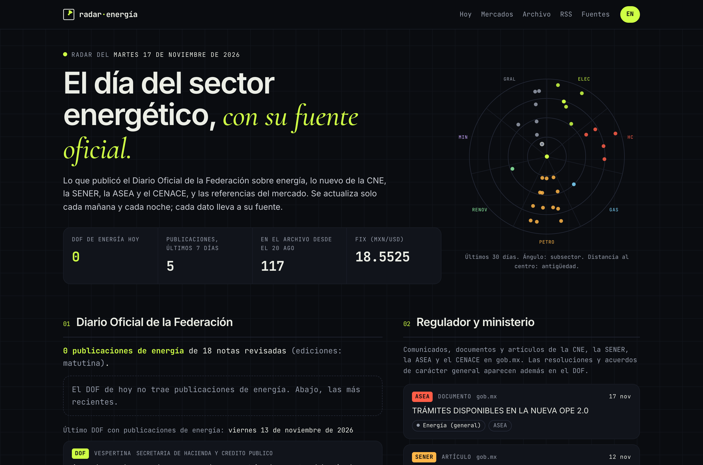
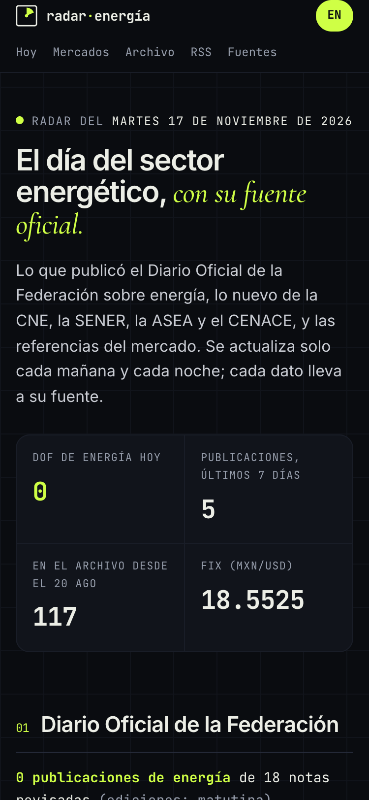
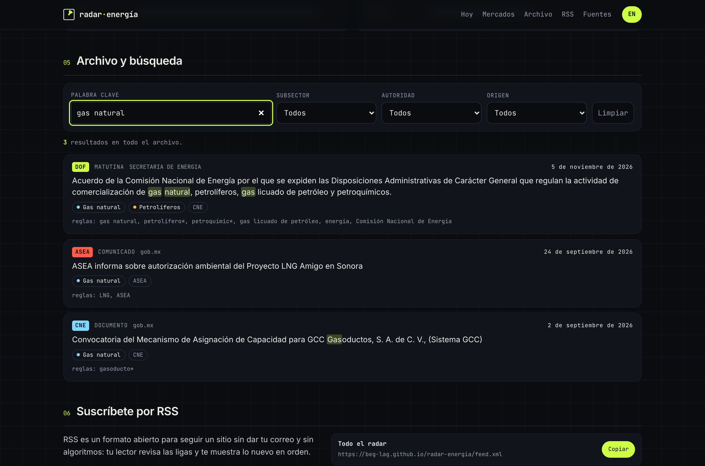
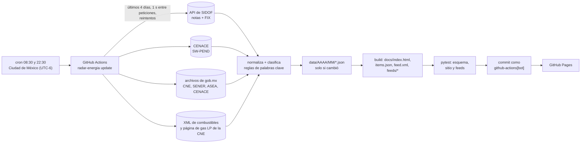

<p align="center">
  <a href="https://pivotek.mx"></a>
</p>

<p align="center">
  
</p>

<p align="center">
  <a href="README.md">English</a> · <b>Español</b>
</p>

<p align="center">
  <a href="https://github.com/BEG-lag/radar-energia/actions/workflows/update.yml"></a>
  <a href="https://github.com/BEG-lag/radar-energia/actions/workflows/ci.yml"></a>
  
  
  <a href="LICENSE"></a>
  <a href="DATA-LICENSE.md"></a>
  
</p>

**radar·energía** es un radar diario del sector energético en México. Cada mañana y cada noche,
GitHub Actions lee las fuentes oficiales y reconstruye una página estática con lo que publicó el
Diario Oficial de la Federación (DOF) sobre energía, lo nuevo del regulador (Comisión Nacional de
Energía, CNE) y del ministerio (SENER), además de la ASEA y el CENACE, y las referencias del
mercado del día. Cada dato lleva a su fuente oficial. Sin resúmenes de inteligencia artificial, sin
cuentas y sin llaves de API: títulos oficiales, reglas de palabras clave públicas y datos abiertos.

**Sitio:** [beg-lag.github.io/radar-energia](https://beg-lag.github.io/radar-energia/) ·
**Feeds:** [`feed.xml`](https://beg-lag.github.io/radar-energia/feed.xml) y uno por subsector ·
**Datos:** [`data/`](data) · **Fuentes:** [`docs/fuentes.md`](docs/fuentes.md)

| Escritorio | Teléfono | Búsqueda |
| --- | --- | --- |
|  |  |  |

<p align="center"><sub>Capturas reales del sitio construido con los datos del repositorio y servido en local (Chrome con Playwright).</sub></p>

## Qué muestra

- **01 · DOF.** Las notas de energía de las ediciones del día (matutina, vespertina,
  extraordinaria), con su emisor, subsector, autoridad y los términos de las reglas que
  coincidieron. Si hoy no hay, muestra el último DOF con publicaciones de energía.
- **02 · Regulador y ministerio.** Comunicados, documentos y artículos de la CNE, la SENER, la ASEA
  y el CENACE en gob.mx (sesiones mensuales de la CNE con sus resoluciones, temporadas abiertas,
  avisos de NOM).
- **03 · Referencias del mercado** con minigráficas: tipo de cambio FIX, precios de zonas de carga
  del MDA (CENACE SW-PEND, seis zonas), mediana nacional de gasolinas y diésel reportada por las
  estaciones a la CNE y la liga al PDF semanal vigente de precios máximos de gas LP. Las fuentes que
  no se pueden leer de forma automática aparecen como consulta manual.
- **04 · Pulso:** publicaciones por subsector de la semana y del mes.
- **05 · Archivo y búsqueda:** los últimos 30 días en la página; filtros por palabra clave,
  subsector, autoridad y origen en todo el archivo, con URL para compartir.
- **06 · RSS:** un feed Atom con todo y uno por subsector, con una explicación sencilla para
  suscribirse.
- Español primero, con botón para inglés. Tipografías alojadas en el propio sitio, sin peticiones a
  terceros, sin analítica y sin cookies. Funciona sin JavaScript (la búsqueda y el cambio de idioma
  sí lo necesitan).

### Lo que mostró el primer día (17 de noviembre de 2026)

- **DOF:** la edición matutina traía 18 notas con título y ninguna de energía, así que la página
  mostró el 13 de noviembre: tres acuerdos de la SHCP con el estímulo fiscal semanal del IEPS a
  combustibles y a gasolinas en las regiones fronterizas (vespertina). El 5 de noviembre el
  clasificador detectó *"Acuerdo de la Comisión Nacional de Energía por el que se expiden las
  Disposiciones Administrativas de Carácter General que regulan la actividad de comercialización de
  gas natural, petrolíferos, gas licuado de petróleo y petroquímicos"*, que SIDOF archiva bajo la
  SENER y el radar etiqueta como CNE.
- **gob.mx:** la ASEA publicó "TRÁMITES DISPONIBLES EN LA NUEVA OPE 2.0" a las 14:42; el 6 de
  noviembre la CNE anunció seis permisos para proyectos fotovoltaicos de la segunda convocatoria de
  la SENER.
- **Mercado:** FIX 18.5525 pesos por dólar (0.0663 menos que la publicación anterior). Promedio del
  precio de zona de carga del MDA para el día de operación 17 de noviembre: Monterrey 603.32,
  Guadalajara 739.95, Puebla 1,161.02, Mérida 1,195.57, Hermosillo 498.27 y Mexicali 450.25 pesos
  por MWh. Mediana de 15,531 estaciones: regular 23.99, premium 28.79 y diésel 27.00 pesos por
  litro. Gas LP: "PRECIOS MÁXIMOS VIGENTES DEL 15 AL 21 DE NOVIEMBRE DE 2026" (PDF de la CNE).

### Respaldo inicial

El 17 de noviembre de 2026 se respaldaron 90 días (del 20 de agosto al 17 de noviembre de 2026);
las 103 llamadas a las fuentes funcionaron:

| Fuente | Cobertura |
| --- | --- |
| DOF | 90 fechas consultadas, 62 con edición, 1,122 notas con título revisadas, **79 de energía** |
| gob.mx (CNE, SENER, ASEA, CENACE) | **38 entradas** (sin páginas administrativas) |
| FIX | 61 días hábiles |
| Zonas de carga del CENACE | 90 días de operación por 6 zonas |
| Gasolinas y diésel | 1 lectura: la fuente no guarda histórico, la serie crece un punto por día |
| Precios máximos de gas LP | solo la liga al PDF semanal vigente |

## Fuentes

Cada fuente se probó el 17 de noviembre de 2026 sin cuentas ni tokens, con pausas entre peticiones
y después de leer su `robots.txt`. La evidencia completa (códigos HTTP, límites, qué falló y por
qué) está en [`docs/fuentes.md`](docs/fuentes.md).

| Semáforo | Fuente | Emisor | Uso |
| --- | --- | --- | --- |
| VERDE | Índice del DOF, API de SIDOF | Segob | Automático |
| VERDE | Tipo de cambio FIX, indicadores de SIDOF | Banxico vía DOF | Automático |
| VERDE | Precios de zonas de carga del MDA, servicio web SW-PEND | CENACE | Automático |
| VERDE | Precios de gasolinas y diésel por estación (XML) | CNE | Automático (desde el primer día) |
| VERDE | Precios por nodo, servicio web SW-PML | CENACE | Funciona, no se usa |
| AMARILLO | Prensa, documentos y artículos en gob.mx (solo HTML, sin RSS) | CNE, SENER, ASEA, CENACE | Automático, solo título, fecha y liga |
| AMARILLO | Precios máximos de gas LP (PDF semanal) | CNE | Liga al PDF vigente |
| ROJO | Índice de precios de gas natural (IPGN) | CNE | Manual: reCAPTCHA |
| ROJO | Demanda del Sistema Eléctrico Nacional | CENACE | Manual: gráfica web sin servicio documentado |
| ROJO | Mezcla mexicana de exportación | Pemex | Manual: `robots.txt` lo impide y Banxico SIE pide token |
| ROJO | datos.gob.mx, sitio anterior de la CRE, portal de CONAMER | | 403 o el dominio no resuelve |

## Cómo funciona



| Horario (cron, UTC) | Ciudad de México | Para qué |
| --- | --- | --- |
| `30 14 * * *` | 08:30 | después de la edición matutina del DOF |
| `30 4 * * *` | 22:30 | después de la mayoría de las vespertinas |

- **Determinista.** Los archivos del día no guardan la hora de consulta y se escriben en orden
  fijo; los feeds usan la fecha de la publicación más reciente, no la del build. Solo hay commit
  cuando una fuente oficial cambió.
- **Falla en silencio.** Una fuente que falla se registra y se omite; una caída nunca borra datos
  guardados. La corrida solo falla si fallan todas.
- **Educado.** Peticiones en secuencia con al menos un segundo entre cada una por servidor, tiempo
  máximo de 30 s, reintentos con espera exponencial, User-Agent genérico, respeto a `robots.txt` y
  ningún CAPTCHA evadido.
- **Clasificación transparente.** Los subsectores (electricidad, hidrocarburos, gas natural,
  petrolíferos, renovables, minería, energía general) y las autoridades (SENER, CNE, ASEA, CENACE,
  CENAGAS, CFE, Pemex) salen de reglas públicas en [`rules.py`](src/radar_energia/rules.py). Cada
  tarjeta muestra los términos que coincidieron. Con las reglas de la versión 1.0.0, 79 de 1,122
  notas del DOF en 90 días (7%) resultaron de energía.

## Usa los datos

Un archivo por día, `data/AAAA/MM/AAAA-MM-DD.json`, descrito por el
[JSON Schema](schema/day.schema.json) y validado en cada corrida:

```bash
curl -s https://raw.githubusercontent.com/BEG-lag/radar-energia/main/data/2026/11/2026-11-05.json \
  | jq '.dof.items[] | {title, subsectors, agencies, url}'
```

El sitio también publica [`data/items.json`](https://beg-lag.github.io/radar-energia/data/items.json)
(todas las publicaciones), [`data/markets.json`](https://beg-lag.github.io/radar-energia/data/markets.json)
(series de precios) y [`data/latest.json`](https://beg-lag.github.io/radar-energia/data/latest.json)
(resumen del día y variaciones).

## Córrelo tú

```bash
uv sync
uv run radar-energia backfill --days 90   # primer día
uv run radar-energia update --days 4      # lo que corre el flujo programado
uv run radar-energia build                # reconstruye docs/ desde data/
uv run radar-energia reclassify           # después de editar rules.py
uv run pytest                             # sin red: solo respuestas grabadas
python -m http.server 8000 --directory docs
```

Las capturas y las pruebas en navegador (sin scroll horizontal a 375 px, búsqueda, cambio de
idioma, sin errores en consola) usan el Google Chrome local con `playwright-core`:

```bash
PLAYWRIGHT_CORE=/ruta/a/node_modules/playwright-core node scripts/screenshots.mjs
```

**Por qué un sitio estático sencillo y no Vite:** todo el proceso es Python y la página es sobre
todo datos que se renderizan dos veces al día, así que Python la arma directamente (funciona sin
JavaScript) y un solo script pequeño agrega la búsqueda y el inglés. Sin cadena de Node que
mantener en el flujo programado, nada que empaquetar y nada de terceros.

## Limitaciones

- **Títulos, no textos.** El radar lista títulos oficiales y ligas; no lee ni resume los
  documentos. Lee la nota del DOF o la página de la autoridad antes de apoyarte en algo.
- **Las reglas de palabras clave fallan en ambos sentidos.** Una nota de energía cuyo título no usa
  ningún término se pierde; un título que menciona un término de paso entra. Cada tarjeta muestra
  por qué entró.
- **gob.mx es HTML.** Si cambia la plantilla del CMS, la sección de autoridades deja de encontrar
  entradas hasta ajustar el lector (nunca inventa entradas). Las resoluciones de la CNE dentro de
  los PDF de cada sesión se enlazan, no se listan una por una.
- **Los precios de combustibles empiezan el primer día.** El XML de la CNE no trae histórico; los
  valores fuera de 5 a 60 pesos por litro (marcadores como 0.01) se excluyen y se cuentan.
- **Seis zonas de carga.** Las zonas con espacio en el nombre (por ejemplo Valle de México) no se
  pueden pedir a SW-PEND; los promedios son medias simples de 24 horas, no índices oficiales.
- **Fuera de lo automático:** el índice de precios de gas natural (IPGN), la demanda del sistema y
  la mezcla mexicana de exportación (ver la tabla de fuentes).
- **Avisos** judiciales y generales quedan fuera: SIDOF solo les pone códigos como título.

## Aviso

Información pública recopilada automáticamente. No constituye asesoría legal. Solo el DOF y las
autoridades emisoras son fuente oficial.

## Licencia

Código bajo la [licencia MIT](LICENSE). Los datos compilados en `data/` y los índices generados se
dedican al dominio público bajo [CC0 1.0](DATA-LICENSE.md). Las tipografías usan la SIL Open Font
License ([`docs/assets/fonts`](docs/assets/fonts)).

## Autor

**Benjamín Esponda García**, abogado corporativo mexicano en energía, hidrocarburos y minería que
construye con inteligencia artificial. [**PIVOTEK**](https://pivotek.mx), *Asesoría legal en
Energía e Infraestructura*.

Proyectos abiertos relacionados: [dof-diario](https://github.com/BEG-lag/dof-diario) (todo el
sumario del DOF desde 2025) y [mcp-dof](https://github.com/BEG-lag/mcp-dof) (el DOF para
asistentes de IA).

Versión 1.0.0.
