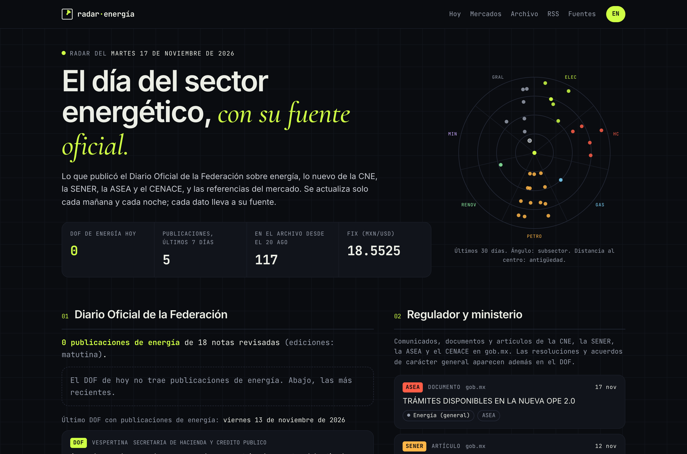
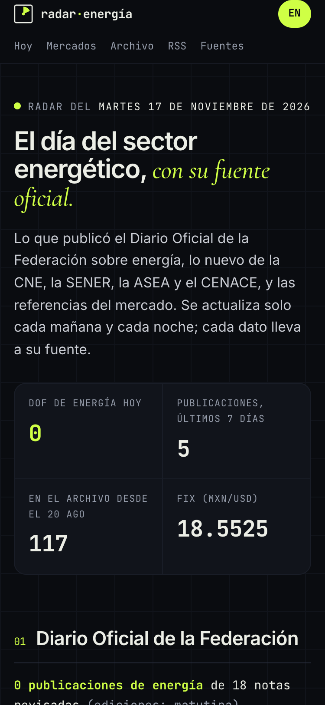
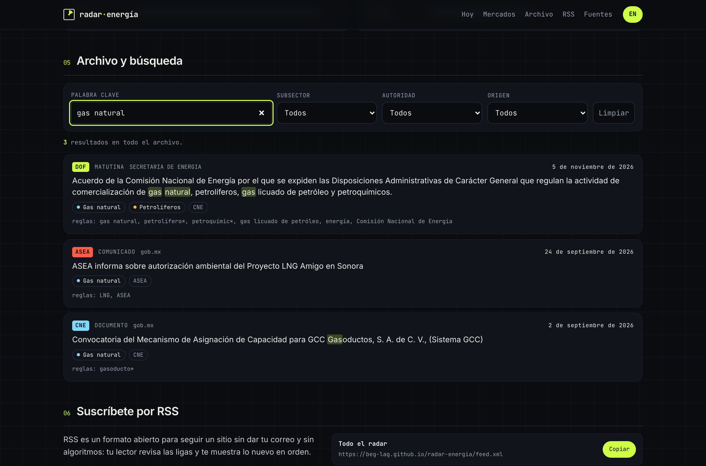
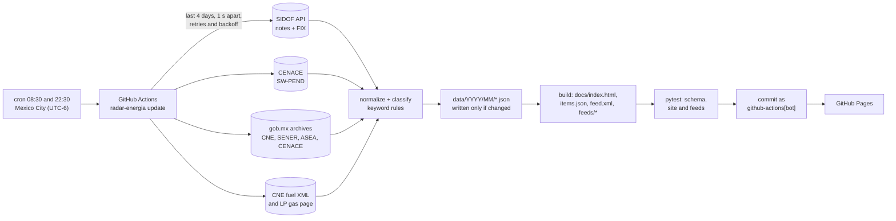

<p align="center">
  <a href="https://pivotek.mx"></a>
</p>

<p align="center">
  
</p>

<p align="center">
  <b>English</b> · <a href="README.es.md">Español</a>
</p>

<p align="center">
  <a href="https://github.com/BEG-lag/radar-energia/actions/workflows/update.yml"></a>
  <a href="https://github.com/BEG-lag/radar-energia/actions/workflows/ci.yml"></a>
  
  
  <a href="LICENSE"></a>
  <a href="DATA-LICENSE.md"></a>
  
</p>

**radar·energía** is a daily radar of Mexico's energy sector. Every morning and every evening
GitHub Actions reads the official sources and rebuilds a static page with what the *Diario Oficial
de la Federación* (DOF) published that touches energy, what is new from the regulator (Comisión
Nacional de Energía, CNE) and the ministry (SENER), plus ASEA and CENACE, and the day's market
references. Every item links to its official source. No AI summaries, no accounts, no API keys:
official titles, transparent keyword rules and public data.

**Site:** [beg-lag.github.io/radar-energia](https://beg-lag.github.io/radar-energia/) ·
**Feeds:** [`feed.xml`](https://beg-lag.github.io/radar-energia/feed.xml) and one per subsector ·
**Data:** [`data/`](data) · **Sources:** [`docs/fuentes.md`](docs/fuentes.md) (Spanish)

| Desktop | Phone | Search |
| --- | --- | --- |
|  |  |  |

<p align="center"><sub>Real screenshots of the site built from the committed data and served locally (Chrome via Playwright).</sub></p>

## What the radar shows

- **01 · DOF.** Energy notes of today's editions (matutina, vespertina, extraordinaria), each with
  its issuer, subsector and agency tags and the rule terms that matched. When today has none, the
  latest DOF with energy items.
- **02 · Regulator and ministry.** Press releases, documents and articles of CNE, SENER, ASEA and
  CENACE on gob.mx (CNE monthly session documents with its resolutions, open seasons, NOM
  announcements).
- **03 · Market references** with sparklines: FIX exchange rate, day-ahead load zone prices
  (CENACE SW-PEND, six zones), national median of gasoline and diesel prices reported by stations
  to the CNE, and a link to the current weekly PDF of LP gas maximum prices. Sources that cannot be
  read automatically are listed for manual lookup.
- **04 · Pulse:** items per subsector this week and this month.
- **05 · Archive and search:** the last 30 days on the page; keyword, subsector, authority and
  origin filters over the whole archive, with shareable URLs.
- **06 · RSS:** an Atom feed with everything and one per subsector, with a plain explanation of
  how to subscribe.
- Spanish first, English toggle. Self-hosted fonts, no third-party requests, no analytics, no
  cookies. Works without JavaScript (search and the language toggle need it).

### What it showed on day one (17 November 2026)

- **DOF:** the matutina edition had 18 titled notes and none on energy, so the page fell back to
  13 November: three SHCP agreements with the weekly IEPS fiscal stimulus on fuels and gasoline in
  the border regions (vespertina). On 5 November the classifier caught *"Acuerdo de la Comisión
  Nacional de Energía por el que se expiden las Disposiciones Administrativas de Carácter General
  que regulan la actividad de comercialización de gas natural, petrolíferos, gas licuado de
  petróleo y petroquímicos"*, filed by SIDOF under SENER and tagged CNE.
- **gob.mx:** ASEA published "TRÁMITES DISPONIBLES EN LA NUEVA OPE 2.0" at 14:42; on 6 November the
  CNE announced six permits for photovoltaic projects in SENER's second call.
- **Markets:** FIX 18.5525 MXN/USD (down 0.0663 from the previous publication). Day-ahead average
  zone prices for operating day 17 November: Monterrey 603.32, Guadalajara 739.95, Puebla 1,161.02,
  Mérida 1,195.57, Hermosillo 498.27 and Mexicali 450.25 MXN/MWh. Median retail prices across
  15,531 stations: regular 23.99, premium 28.79 and diesel 27.00 MXN per litre. LP gas: "PRECIOS
  MÁXIMOS VIGENTES DEL 15 AL 21 DE NOVIEMBRE DE 2026" (CNE PDF).

### Backfill

On 17 November 2026 the radar was backfilled for 90 days (20 August to 17 November 2026); all 103
source calls succeeded:

| Source | Coverage |
| --- | --- |
| DOF | 90 dates requested, 62 with an edition, 1,122 titled notes reviewed, **79 energy notes** |
| gob.mx (CNE, SENER, ASEA, CENACE) | **38 entries** (housekeeping pages excluded) |
| FIX | 61 business days |
| CENACE load zones | 90 operating days × 6 zones |
| Gasoline and diesel | 1 snapshot: the source keeps no history, the series grows one point a day |
| LP gas maximum prices | link to the current weekly PDF only |

## Sources

Every source was tested on 17 November 2026 without accounts or tokens, with pauses between
requests and after reading `robots.txt`. The full evidence (status codes, limits, what failed and
why) is in [`docs/fuentes.md`](docs/fuentes.md).

| Status | Source | Publisher | Use |
| --- | --- | --- | --- |
| GREEN | DOF tables of contents, SIDOF API | Segob | Automatic |
| GREEN | FIX exchange rate, SIDOF indicators | Banxico via DOF | Automatic |
| GREEN | Day-ahead load zone prices, SW-PEND web service | CENACE | Automatic |
| GREEN | Gasoline and diesel prices by station (XML) | CNE | Automatic (from day one) |
| GREEN | Node prices, SW-PML web service | CENACE | Works, not used |
| YELLOW | Press, documents and articles on gob.mx (HTML only, no RSS) | CNE, SENER, ASEA, CENACE | Automatic, title, date and link only |
| YELLOW | LP gas maximum prices (weekly PDF) | CNE | Link to the current PDF |
| RED | Natural gas price index (IPGN) | CNE | Manual: reCAPTCHA |
| RED | National grid demand | CENACE | Manual: web chart, no documented service |
| RED | Mexican crude export blend | Pemex | Manual: `robots.txt` disallows, Banxico SIE needs a token |
| RED | datos.gob.mx, former CRE site, CONAMER portal | | 403 or the domain does not resolve |

## How it works



| Schedule (cron, UTC) | Mexico City | Purpose |
| --- | --- | --- |
| `30 14 * * *` | 08:30 | after the DOF matutina (morning) edition |
| `30 4 * * *` | 22:30 | after most vespertina (evening) editions |

- **Deterministic.** Day files hold no fetch timestamps and are written in a fixed order; feeds use
  the newest item's date, not the build time. A commit appears only when an official source
  changed.
- **Fail soft.** A source that fails is logged and skipped; stored data is never erased by an
  outage. The run fails only if every source fails.
- **Polite.** Sequential requests at least one second apart per host, 30 s timeout, retries with
  exponential backoff, a generic User-Agent, `robots.txt` respected, no CAPTCHA ever bypassed.
- **Transparent classification.** Subsectors (electricity, hydrocarbons, natural gas, petroleum
  products, renewables, mining, general energy) and agencies (SENER, CNE, ASEA, CENACE, CENAGAS,
  CFE, Pemex) come from public keyword rules in [`rules.py`](src/radar_energia/rules.py). Each card
  shows the terms that matched. With the 1.0.0 rules, 79 of 1,122 DOF notes (7%) in 90 days were
  energy items.

## Use the data

One file per day, `data/YYYY/MM/YYYY-MM-DD.json`, documented by the
[JSON Schema](schema/day.schema.json) and validated on every run:

```bash
curl -s https://raw.githubusercontent.com/BEG-lag/radar-energia/main/data/2026/11/2026-11-05.json \
  | jq '.dof.items[] | {title, subsectors, agencies, url}'
```

The site also publishes [`data/items.json`](https://beg-lag.github.io/radar-energia/data/items.json)
(every item), [`data/markets.json`](https://beg-lag.github.io/radar-energia/data/markets.json)
(price series) and [`data/latest.json`](https://beg-lag.github.io/radar-energia/data/latest.json)
(today's summary and day-over-day changes).

## Run it yourself

```bash
uv sync
uv run radar-energia backfill --days 90   # day one
uv run radar-energia update --days 4      # what the scheduled workflow runs
uv run radar-energia build                # rebuild docs/ from data/
uv run radar-energia reclassify           # after editing rules.py
uv run pytest                             # offline: recorded fixtures only
python -m http.server 8000 --directory docs
```

Screenshots and browser smoke checks (no horizontal scroll at 375 px, search, English toggle, no
console errors) use the local Google Chrome through `playwright-core`:

```bash
PLAYWRIGHT_CORE=/path/to/node_modules/playwright-core node scripts/screenshots.mjs
```

## Project structure

```text
src/radar_energia/
  sources/sidof.py    DOF notes and FIX (SIDOF API)
  sources/cenace.py   day-ahead load zone prices (SW-PEND)
  sources/fuel.py     gasoline and diesel prices by station (CNE XML)
  sources/gobmx.py    gob.mx archives and the LP gas PDF link
  rules.py            keyword rules: subsectors, agencies, excluded pages
  classify.py         deterministic matcher
  pipeline.py         fetch, merge, fail soft
  store.py            one canonical JSON file per day
  aggregates.py       counts and price series
  site.py, feeds.py   static page, JSON indexes and Atom feeds
  templates/          page template
docs/                 GitHub Pages site (generated index, feeds, data; hand-written assets)
docs/fuentes.md       source verification (Spanish)
data/                 the dataset
schema/               JSON Schema of a day file
tests/                53 offline tests with recorded fixtures
```

**Why a plain static site and not Vite:** the whole pipeline is Python and the page is mostly
data rendered twice a day, so Python renders it directly (it works without JavaScript) and one
small script adds search and the English toggle. No Node toolchain to keep updated in the
scheduled job, nothing to bundle, nothing from third parties.

## Limitations

- **Titles, not texts.** The radar lists official titles and links; it does not read or summarize
  the documents. Read the DOF note or the authority's page before relying on anything.
- **Keyword rules miss and overreach.** A note about energy whose title uses none of the terms is
  missed; a title that mentions a term in passing is included. Each card shows why it was included.
- **gob.mx is HTML.** If the CMS template changes, the authorities section stops finding entries
  until the parser is updated (it never invents entries). CNE resolutions inside session PDFs are
  linked, not listed one by one.
- **Fuel prices start on day one.** The CNE XML has no history; outliers outside 5 to 60 MXN per
  litre (placeholders such as 0.01) are excluded and counted.
- **Six load zones.** Zones whose names contain spaces (for example Valle de México) cannot be
  requested from SW-PEND; the averages are simple 24-hour means, not official indices.
- **Not covered automatically:** the natural gas price index (IPGN), grid demand and the Mexican
  crude export blend (see the sources table).
- **Avisos** (judicial and general notices) are excluded: SIDOF only gives them codes as titles.

## Disclaimer

Información pública recopilada automáticamente. No constituye asesoría legal. Solo el DOF y las
autoridades emisoras son fuente oficial. (Public information compiled automatically. Not legal
advice. Only the DOF and the issuing authorities are official sources.)

## License

Code under the [MIT License](LICENSE). The compiled data in `data/` and the generated indexes are
dedicated to the public domain under [CC0 1.0](DATA-LICENSE.md). Fonts are under the SIL Open
Font License ([`docs/assets/fonts`](docs/assets/fonts)).

## Author

**Benjamín Esponda García**, Mexican corporate lawyer in energy, hydrocarbons and mining who builds
with AI. [**PIVOTEK**](https://pivotek.mx), *Asesoría legal en Energía e Infraestructura*.

Related open projects: [dof-diario](https://github.com/BEG-lag/dof-diario) (the whole DOF table of
contents since 2025) and [mcp-dof](https://github.com/BEG-lag/mcp-dof) (DOF for AI assistants).

Version 1.0.0.
